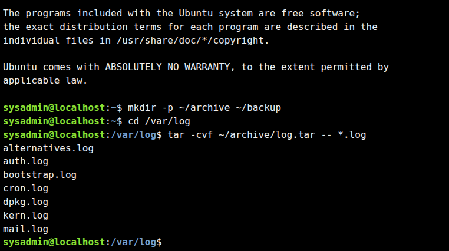
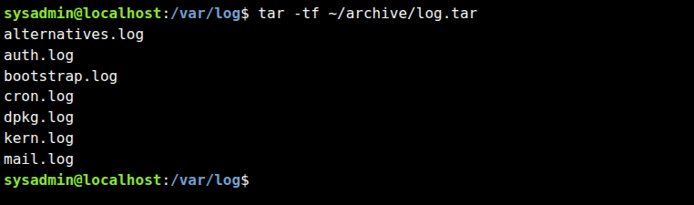
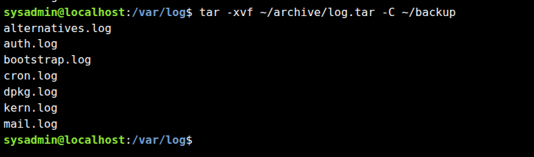
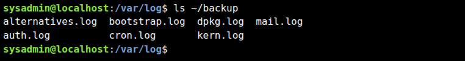

# Challenge Lab C — Archiving and Backup

Study notes for Cisco Networking Academy / NDG **Linux Essentials**.

**Status:** Completed. The four terminal screenshots supplied for this lab confirm successful archive creation, archive listing, extraction, and backup listing.

## 1. Lab Overview

**Scenario:** Suspicious system activity requires preserving the current `.log` files from `/var/log` in an uncompressed TAR archive, followed by extraction to a separate backup directory.

**Curriculum:** Module 6 — Getting Help; Module 7 — Navigating the Filesystem; Module 8 — Managing Files and Directories; Module 9 — Archiving and Compression.

**Requirements:**

- Create `~/archive/log.tar` from files ending in `.log` directly in `/var/log`.
- Store names without absolute paths.
- Display filenames during archive creation.
- List archive members without extracting them.
- Extract into `~/backup` and verify the result.

## 2. Commands Executed in the Lab

```bash
mkdir -p ~/archive ~/backup
cd /var/log
tar -cvf ~/archive/log.tar -- *.log
tar -tf ~/archive/log.tar
tar -xvf ~/archive/log.tar -C ~/backup
ls ~/backup
```

These commands match the provided terminal screenshots. The `--` marker ends option processing before the filename list. Because the shell is in `/var/log` when `*.log` expands, TAR receives simple filenames such as `auth.log`, not `/var/log/auth.log`. The archive consequently stores flat names without directory prefixes.

### 2.1. Create the directories

```bash
mkdir -p ~/archive ~/backup
```

`~` refers to the current user's home directory. `mkdir -p` creates missing directories and tolerates already-existing directories.

### 2.2. Create the archive with verbose output

```bash
cd /var/log
tar -cvf ~/archive/log.tar -- *.log
```

| Option | Meaning |
|---|---|
| `-c` | Create an archive |
| `-v` | Print each processed filename |
| `-f FILE` | Use the specified archive file |
| `--` | Stop parsing command-line options |
| `*.log` | Shell glob matching `.log` filenames in the current directory |

**Observed output:**

```text
alternatives.log
auth.log
bootstrap.log
cron.log
dpkg.log
kern.log
mail.log
```

### 2.3. List the archive without extraction

```bash
tar -tf ~/archive/log.tar
```

`-t` lists archive members. The screenshot shows the same seven filenames, with no `/var/log/` prefix.

### 2.4. Extract to the backup directory

```bash
tar -xvf ~/archive/log.tar -C ~/backup
```

| Option | Meaning |
|---|---|
| `-x` | Extract archive members |
| `-v` | Show extracted filenames |
| `-f FILE` | Read the specified TAR archive |
| `-C DIR` | Change extraction destination to `DIR` |

### 2.5. Verify extracted files

```bash
ls ~/backup
```

**Observed output (column formatting may vary):**

```text
alternatives.log  bootstrap.log  dpkg.log  mail.log
auth.log          cron.log       kern.log
```

The screenshot confirms that the seven expected names are present in the backup directory. It does not, by itself, verify file contents byte-for-byte.

## 3. Screenshot Evidence

### Archive creation



### Archive listing



### Archive extraction



### Backup directory listing



## 4. TAR Fundamentals

A TAR archive **bundles files**, but it does not automatically compress them. `log.tar` is uncompressed. Common alternatives include `tar -czf archive.tar.gz ...` (gzip) and `tar -cJf archive.tar.xz ...` (xz), but neither is requested here.

The working directory matters: the shell expands `*.log` **before** `tar` runs. For example, running `tar -cvf ~/archive/log.tar -C /var/log -- *.log` from another directory does **not** make the glob expand inside `/var/log`. Changing to `/var/log` first, as shown in the screenshots, is the correct approach for this lab.

The glob `*.log` selects matching entries directly in the current directory, not recursively in subdirectories. Hidden filenames beginning with `.` are not included by default. If the current directory has no matches, the literal `*.log` may be passed to `tar`, causing an error.

## 5. Alternative: Professional Bash Automation

The companion script, [`backup-logs.sh`](backup-logs.sh), automates the same workflow while adding defensive checks:

- Configurable source, archive, and backup directories.
- Detection of missing or unreadable source files.
- NUL-delimited filename handling, including spaces and unusual characters.
- Refusal to overwrite an existing `log.tar` or extracted file.
- Temporary archive staging, with cleanup on failure.
- Archive listing, verbose extraction, and `cmp` verification of each extracted file against the source.
- Noninteractive execution and nonzero exit codes on failures.

**Run in the NetAcad lab environment:**

```bash
chmod +x backup-logs.sh
./backup-logs.sh
```

**Important:** Because the manual lab has already created `~/archive/log.tar` and populated `~/backup`, the script will intentionally refuse to overwrite those results. To test safely, use separate destinations:

```bash
./backup-logs.sh --archive-dir "$HOME/archive-automated" --backup-dir "$HOME/backup-automated"
```

For a completely isolated test with sample files:

```bash
mkdir -p "$HOME/log-sample"
printf 'sample log\n' > "$HOME/log-sample/sample.log"
./backup-logs.sh \
  --source "$HOME/log-sample" \
  --archive-dir "$HOME/archive-test" \
  --backup-dir "$HOME/backup-test"
```

The automation assumes GNU `tar`, GNU `find`, GNU `sort`, Bash, and standard Linux utilities. It does not elevate privileges automatically; unreadable logs require an authorized execution context. The `cmp` check compares the extracted files with the **current** source files, so actively changing logs can cause a mismatch even if the archive itself was created correctly. A production incident-response process would additionally address evidence preservation, timestamps, cryptographic hashes, chain of custody, and avoiding modification of the original system.

## 6. Troubleshooting and Exam Notes

| Issue | Explanation / action |
|---|---|
| `Permission denied` while archiving | The current user cannot read one or more logs. Check permissions and use authorized privileges if required. |
| `Cannot stat: *.log` | The glob did not match files in the current directory. Check `pwd` and `ls *.log`. |
| Archive contains path prefixes | Archive names depend on the paths passed to TAR; run from `/var/log` with relative names. |
| Archive exists but extraction fails | Verify with `tar -tf`, confirm the destination directory exists, and check write permissions. |
| `tar -z` vs. plain TAR | `-z` requests gzip; it is unnecessary for the requested `log.tar`. |

**Quick reference:** `tar -cvf` creates; `tar -tf` lists; `tar -xvf` extracts; `tar -C` selects a directory; `mkdir -p` creates directories; `ls` verifies directory entries.

## 7. Lab Result

All requested operations are supported by the four provided screenshots. The archive and extracted backup both contain the seven expected `.log` filenames.
