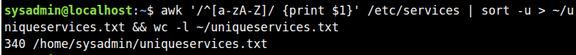
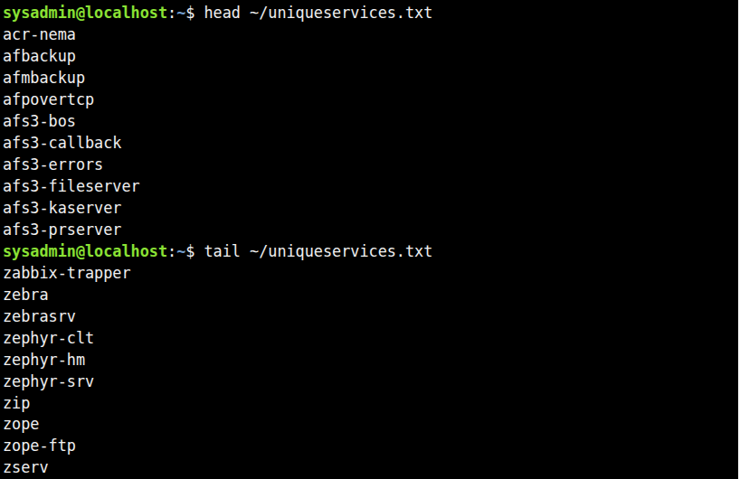

# Challenge Lab D: Pipes, Redirection and REGEX

Study notes and verified lab evidence for **Cisco Networking Academy — Linux Essentials**.

## 1. Lab Overview

**Scenario:** A staff member needs an alphabetical, duplicate-free list of service names from `/etc/services`. The result must be saved as `~/uniqueservices.txt` without creating intermediate files. A line count must run conditionally after successful processing.

**Curriculum:** Module 5 — Command Line Skills; Module 6 — Getting Help; Module 7 — Navigating the Filesystem; Module 10 — Working with Text.

**Observed outcome:** The NetAcad Ubuntu image produced **340 unique service names**, and the first and last ten entries matched the lab's expected output.

## 2. Final Command Used in the Lab

```bash
awk '/^[a-zA-Z]/ {print $1}' /etc/services | sort -u > ~/uniqueservices.txt && wc -l ~/uniqueservices.txt
```

Observed terminal output:

```text
340 /home/sysadmin/uniqueservices.txt
```

The command performs all transformations in a pipeline, without temporary files:

1. `awk` selects lines beginning with an ASCII letter and prints the first whitespace-delimited field.
2. `|` sends the extracted names to `sort` through standard output and standard input.
3. `sort -u` sorts the names and removes duplicates.
4. `>` writes the final names to `~/uniqueservices.txt` (overwriting an existing file).
5. `&&` runs `wc -l` only when the pipeline reports success.

**Shell nuance:** By default, Bash reports the exit status of the last command in a pipeline. To detect failure in any pipeline stage, run `set -o pipefail` before the command, or use the provided script, which enables `pipefail` automatically.

## 3. Understanding the Regular Expression

```bash
awk '/^[a-zA-Z]/ {print $1}' /etc/services
```

| Expression | Meaning |
|---|---|
| `^` | Start of the line |
| `[a-zA-Z]` | One uppercase or lowercase ASCII letter |
| `/^[a-zA-Z]/` | Process only lines whose first character is a letter |
| `{print $1}` | Print the first field (the service name) |

This excludes comment lines beginning with `#`, blank lines, and other lines not beginning with a letter. It does not remove inline comments directly; that is unnecessary because only the first field is printed.

The file may contain multiple protocol entries for the same service, such as `echo 7/tcp` and `echo 7/udp`. `sort -u` keeps a single `echo` entry.

## 4. Troubleshooting: Why `head /etc/services` Showed Only Comments

The initial command:

```bash
head /etc/services
```

showed only the comment header of the file. **This was not an empty file or an error.** The first ten lines of `/etc/services` are documentation comments in the lab image.

To inspect actual service definitions:

```bash
grep -v '^#' /etc/services | head -20
grep '^[a-zA-Z]' /etc/services | head -10
awk '/^[a-zA-Z]/ {print $1}' /etc/services | head -10
```

The observed entries included `tcpmux`, `echo`, `discard`, `systat`, `daytime`, and others. Some appeared twice because of separate TCP and UDP definitions.

Another common source of confusion is output redirection: the `>` operator writes the service list to a file instead of displaying it in the terminal. The trailing `&& wc -l` displays the count when processing succeeds.

## 5. Verification and Actual Results

```bash
wc -l ~/uniqueservices.txt
head ~/uniqueservices.txt
tail ~/uniqueservices.txt
```

**Observed count:**

```text
340 /home/sysadmin/uniqueservices.txt
```

**First ten names:**

```text
acr-nema
afbackup
afmbackup
afpovertcp
afs3-bos
afs3-callback
afs3-errors
afs3-fileserver
afs3-kaserver
afs3-prserver
```

**Last ten names:**

```text
zabbix-trapper
zebra
zebrasrv
zephyr-clt
zephyr-hm
zephyr-srv
zip
zope
zope-ftp
zserv
```

The count of 340 is specific to the NetAcad lab image; other Linux distributions and `/etc/services` versions may contain different numbers of entries.

### Lab Screenshots

**Archive-free pipeline and conditional line count:**



**Verification with `head` and `tail`:**



## 6. Professional Bash Automation

The repository also includes [`extract-services.sh`](extract-services.sh), a reusable, parameterized version of the lab solution.

Features:

- Bash strict mode: `set -Eeuo pipefail`.
- Validation of the input file and destination directory.
- Protection against using the same file as both input and output.
- ASCII filtering and consistent sorting under the `C` locale.
- No intermediate files; writes directly to the requested output.
- Conditional line counting, optional expected-count validation, and first/last-ten previews.
- Clear error messages and nonzero exit codes for failures.

Make it executable:

```bash
chmod +x extract-services.sh
```

Run with the default paths:

```bash
./extract-services.sh
```

Require the exact NetAcad count:

```bash
./extract-services.sh --expect-count 340
```

Use alternative paths:

```bash
./extract-services.sh \
  --input /etc/services \
  --output "$HOME/uniqueservices-test.txt"
```

**Note:** The script intentionally overwrites its output file, just like the original lab command. Do not point it at a file containing data you want to preserve.

## 7. Command Reference

| Command or operator | Purpose |
|---|---|
| `awk` | Filter lines and extract fields |
| `grep` | Find lines matching a regular expression |
| `sort -u` | Sort and remove duplicates |
| `|` | Pipe standard output to the next command |
| `>` | Redirect output to a file (overwrite) |
| `&&` | Execute the next command only after success |
| `wc -l` | Count lines |
| `head` / `tail` | Inspect the beginning or end of a file |
| `set -o pipefail` | Detect errors from any stage of a pipeline |
| `$?` | Inspect the exit status of the preceding command |

## 8. Key Takeaways

- Comments at the top of `/etc/services` do not imply that the file is empty.
- Field extraction with `awk` avoids including ports, protocols, aliases, and inline comments.
- `sort -u` combines alphabetical ordering and deduplication.
- Output redirection prevents the full service list from appearing on screen.
- `&&` implements conditional execution, while `pipefail` improves pipeline error detection.
- The lab's final output was verified against the expected 340 service names.

**Lab status:** Completed and verified using terminal screenshots from the NetAcad environment.
